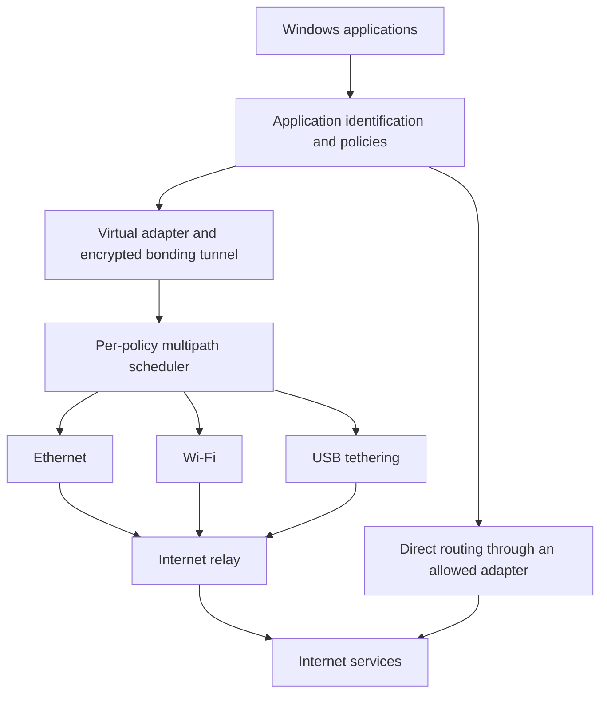

# Network Splicing

### More connections. More control.

**A Windows-first project to combine independent internet connections and give every application its own network policy.**

Ethernet for your game. Wi-Fi for your browser. Ethernet and USB tethering together for a large download. Network Splicing aims to make those choices visible, understandable, and enforceable.

> **Status: design and planning.** This repository currently contains the project vision and engineering plan. There is no working client, networking driver, or relay implementation yet. All capabilities below are planned, not shipped.

## The idea

Most PCs can connect to several networks, but ordinary routing does not turn those connections into one faster internet connection or provide convenient per-application control.

Network Splicing has two goals:

1. **Increase usable download and upload throughput** by bonding independent connections through a relay.
2. **Give users explicit control** over which networks each application may use, including combinations of networks, priorities, backup paths, and metered-data limits.

Inspired by the network-bonding category, including products such as Speedify. This is an independent project with no affiliation with those products.

## What we want to build

| Planned capability | Example |
| --- | --- |
| Application pinning | Keep a browser on Wi-Fi only |
| Application-specific bonding | Let a downloader combine Ethernet and USB tethering |
| Connection load balancing | Spread separate transfers across allowed networks |
| Failover | Keep a tunneled session alive when an access network disappears |
| Network priorities | Prefer Ethernet and use mobile data only as a backup |
| Metered-data controls | Limit tethering usage and block it for background applications |
| Live visibility | Show which application uses which network and how much data it consumes |

These modes solve different problems. Load balancing does not generally accelerate a single ordinary TCP connection; true bonding can, but requires additional infrastructure and careful scheduling.

## Example setup

| Application | Allowed networks | Policy |
| --- | --- | --- |
| Download manager | Ethernet + USB tethering | Bond for throughput |
| Browser | Wi-Fi | Pin to Wi-Fi |
| Game | Ethernet + Wi-Fi | Prefer Ethernet; Wi-Fi backup |
| Backup client | Ethernet + Wi-Fi | Balance separate connections; exclude mobile data |
| Upload tool | Ethernet + USB tethering | Bond, with a mobile-data budget |

Allowed networks define eligibility. An adaptive scheduler may temporarily avoid an allowed connection if using it would reduce performance.

## How it is expected to work

The relay combines outgoing traffic and distributes incoming traffic across active paths. Destination services see the relay's public IP for tunneled traffic.

**A relay is generally necessary to combine multiple links for one ordinary application connection without changes to the destination server.** A local-only routing tool cannot promise the same capability.

## Honest expectations

- Independent connections may provide additional capacity. Ethernet and Wi-Fi on the same home internet service usually share the same upstream bottleneck.
- Combined speed is not guaranteed to equal the sum of advertised link speeds.
- Higher throughput does not necessarily mean lower latency.
- Direct-route failover can break existing connections when the public IP changes.
- Robust Windows application routing is a substantial systems-engineering task.
- Relay bandwidth has an ongoing cost.

See [limitations and tradeoffs](docs/LIMITATIONS.md) for details.

## Build order

1. Prove adapter selection, application attribution, and two-link transport feasibility.
2. Build network discovery, application selection, and persistent policies.
3. Enforce single-network application routing.
4. Demonstrate genuine two-link bonding through one relay.
5. Add different bonding groups for different applications.
6. Harden reliability, compatibility, installation, and operations.

There are no committed release dates. Milestones depend on measured results and available engineering capacity.

## Documentation

- [Vision and product principles](docs/VISION.md)
- [Proposed architecture](docs/ARCHITECTURE.md)
- [Roadmap and acceptance criteria](docs/ROADMAP.md)
- [Limitations and open questions](docs/LIMITATIONS.md)
- [Contributing](CONTRIBUTING.md)

## Get involved

Early contributions are most useful in Windows networking research, reproducible multipath experiments, architecture reviews, and user workflows. Please distinguish implemented behavior from proposals and support performance claims with measurements.

## Licensing

A software license has not yet been selected. Public repository visibility alone does not grant an open-source license. Licensing will be decided before implementation contributions are accepted.
